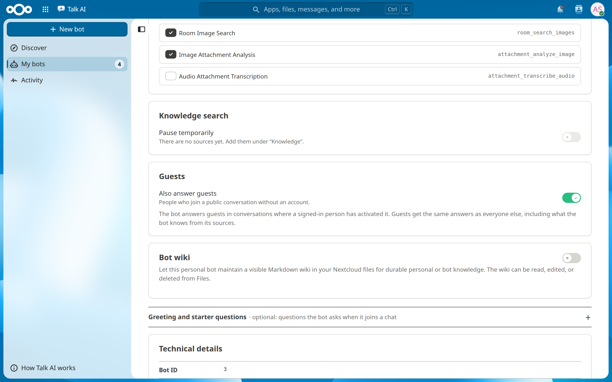

# Bot Setup Guide

Creating and managing bots, from admin configuration to daily use. For installation from source, see [QUICK_START.md](QUICK_START.md).

## 1. Admin Configuration

Before users can create bots, an administrator configures the model access under **Administration settings → Talk AI**:

- **API Endpoint** — any OpenAI-compatible provider, e.g. `https://api.example.com/v1/chat/completions`
- **API Key**
- **Default Model** — a model name your provider serves
- **Webhook Secret** — a secure random string (`openssl rand -hex 32`)

Save the settings before testing.

## 2. Register the Talk Bot

Talk AI registers the shared Talk bot automatically on app enable and settings save. If your environment blocks that, register manually — **the webhook URL must include `/index.php`**:

```bash
sudo -u www-data php occ talk:bot:install \
  -f webhook,response \
  "Talk AI" \
  "YOUR_WEBHOOK_SECRET" \
  "https://cloud.example.com/index.php/apps/educai/webhook/talk"
```

If the bot doesn't respond later, this URL is the first thing to check — see [TROUBLESHOOTING.md](TROUBLESHOOTING.md).

## 3. Activate the Bot in a Talk Room

1. Open a Talk conversation and its settings (⚙️).
2. Find "Talk AI" in the bots list and activate it.

## 4. Create a Bot

In the Talk AI app, click **New bot**, pick a template (or start empty) and follow the five steps:

1. **Basics** — name, the @mention in Talk (unique, cannot be changed later), a short description and the instruction that defines the bot's role and behavior
2. **Who uses it?** — only you, certain groups, certain teams, or everyone (shared bots go through approval)
3. **Knowledge** — files, folders or web pages the bot answers from
4. **Capabilities** — for example reading documents in the chat or understanding images
5. **Check & finish** — a summary; **Advanced** holds the model, the creativity and the guest switch

The sidebar shows the bot as others will see it. Its preview chat answers with the instruction and the model of the form before the bot exists; knowledge and capabilities work once the bot is created.

Then use it in any room where Talk AI is active:

```
@supportbot How do I reset my password?
```

Several bots can be active in the same room; each keeps its own conversation history and responds independently.

## System Prompts

Good system prompts define the role, tone, boundaries, and any domain knowledge. Two examples:

```
You are an HR assistant for Acme Corp. Answer questions about company
policies, benefits, and procedures. Always be professional and accurate.
If you don't know the answer, direct users to contact hr@acme.com.
Do not provide legal advice.
```

```
You are a senior software engineer specializing in PHP and Vue.js.
Review code for security vulnerabilities, best practices, performance
issues and style. Provide constructive feedback with specific examples.
```

## Conversation History

- History is kept per bot and per Talk room.
- The context sent to the model is trimmed to a token budget (admin setting `conversationContextTokens`, default 8000); the server considers up to the 50 most recent stored messages.
- Older messages drop out of the model context as the conversation grows. Use `((RESET))` in a room to start fresh (see [ONBOARDING.md](ONBOARDING.md)).

## Managing Bots

**My bots** lists your bots; a click opens the bot page with its tabs (Overview, Basics, Knowledge, Capabilities, Access, Advanced).

- **Edit** — change name, instruction, knowledge, capabilities, model; the mention name is fixed after creation. A save bar collects the changes of all tabs.
- **Changes to an approved shared bot** go into review first; the approved version stays live until then.
- **Delete** — permanently removes the bot and all its conversation history.

## Guests

People who join a public conversation without an account are guests. A bot answers them only when **Also answer guests** is on (bot page → **Advanced**). To let guests ask a bot:

1. Turn the switch on and save. For an approved shared bot the change is reviewed first.
2. Create a public conversation in Talk and activate "Talk AI" there (section 3).
3. Mention the bot once yourself and answer its activation question. Guests cannot activate a bot.
4. Share the link of the conversation. Guests now get answers, in the mode you chose (on mention, or to every message).

The switch does not change who can use the bot with an account. Guests get the same answers as everyone else, including what the bot knows from its sources.



## Bot Management API

```http
GET    /apps/educai/api/v1/bots          # list own bots
POST   /apps/educai/api/v1/bots          # create ({botName, mentionName, systemPrompt, allowGuests?})
PUT    /apps/educai/api/v1/bots/{id}     # update (allowGuests left out = unchanged)
DELETE /apps/educai/api/v1/bots/{id}     # delete
```

Requests use normal Nextcloud authentication.

## Troubleshooting

The most frequent issues, in order:

1. **Bot doesn't respond** → webhook URL missing `/index.php`, bot not activated in the room, or wrong @mention (case-sensitive). See [WEBHOOK_DEBUG_GUIDE.md](WEBHOOK_DEBUG_GUIDE.md).
2. **"Invalid signature"** → webhook secret in settings doesn't match the registered bot. Re-register with the same secret.
3. **Error message about the AI service** → endpoint, key, or model name wrong; test the endpoint with curl.
4. **"Mention name already exists"** → mention names are unique per instance; pick another.
5. **Slow responses** → normal LLM latency is 2–10 s; a smaller model helps.
6. **Blank bot management page** → run `npm run build`, verify `js/educai-main.mjs` exists, hard-refresh the browser.
7. **A guest gets no answer** → the bot's guest switch is off or its change still waits for review, the bot has not been activated in this conversation by a signed-in person, or "Talk AI" is not active in the conversation.
8. **Migration errors after upgrade** →
   ```bash
   sudo -u www-data php occ app:enable educai
   sudo -u www-data php occ upgrade --no-interaction
   sudo -u www-data php occ migrations:status educai
   ```

## Security

- API keys are stored encrypted in the database.
- Webhooks are verified with HMAC-SHA256.
- Users can only edit or delete their own bots; shared bots go through scope-based approval.
- Provider configuration is admin-only.

Issues: https://github.com/EDUCAlliance/talk-ai/issues
